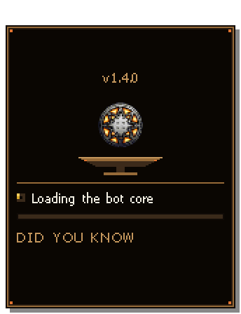
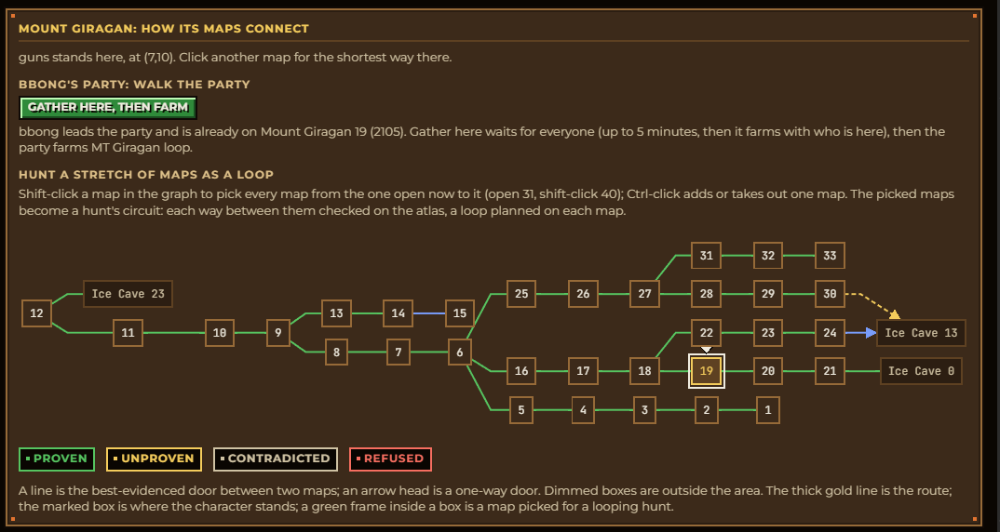
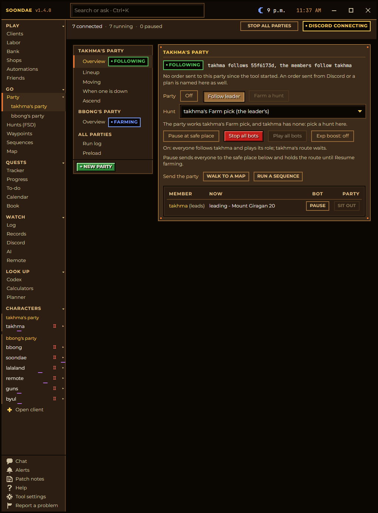

<p align="center">
  
</p>

<h1 align="center">Soondae</h1>

<p align="center">
  A companion tool for <b>Dark Ages</b>: launch every character from one window, let them farm, ascend and regroup on
  their own, and fix the game client's own annoyances while you play.
</p>

<p align="center">
  
</p>

<p align="center">
  <a href="https://github.com/SJhang/Soondae/releases/latest"><b>Download the latest release</b></a> ·
  <a href="docs/getting-started.md">Getting started</a> ·
  <a href="docs/guide.md">The full guide</a> ·
  <a href="https://github.com/sponsors/SJhang">Support Soondae</a>
</p>

---

## What it does

- **Fixes the game client's own bugs** while you play: stuck Shift, Ctrl and Alt after Alt-Tab, a cancelled trade that
  freezes your character, spells lost after leaving an NPC with a menu open, ghost monsters that eat your mana, and more.
  [Game fixes](docs/game-fixes.md)
- **Runs the hands-off loop**: a party farms its hunt, a full experience box walks to the altar and ascends, the party
  waits or keeps farming, everyone regroups and farms on, through the night, until you stop it.
  [The farm, ascend, regroup loop](docs/hands-off-loop.md)
- **Knows the world**: a map atlas of every map and door, learned from what the server did when your characters
  stepped on them, a route to any map in one click, and a Codex of every item, monster, NPC, skill, spell and quest.
  [How it works](docs/how-it-works.md)

  
- **One window for every character**: launch, watch, pause and set each one up from the same place, in the game's own
  pixel style, with cards drawn over the game windows and a Discord bot to check on them from your phone.

<p align="center">
  
</p>

## The guide

| | |
|---|---|
| [Getting started](docs/getting-started.md) | Install, the first launch, connecting a character, bringing your settings over from the old tool, updates |
| [Game fixes](docs/game-fixes.md) | What the tool fixes in the Dark Ages client itself, on its own, with nothing to set up |
| [The farm, ascend, regroup loop](docs/hands-off-loop.md) | The headline workflow, step by step |
| [How it works](docs/how-it-works.md) | The map atlas, what the tool learns while you play, the trackers, how a walk, a waypoint and an NPC conversation fit together, and what the MCP endpoint offers, in diagrams |
| [Every page](docs/guide.md) | A walk through the tool in the order of its left rail, with every feature |
| [Play](docs/guide.md#play) | Clients, Labor, Bank, Shops, Automations, Friends |
| [Go](docs/guide.md#go) | Party, Hunts (FSD), Waypoints, Sequences, Map |
| [Quests](docs/guide.md#quests) | Tracker, Progress, To-do, Calendar, Book |
| [Watch](docs/guide.md#watch) | Log, Records, Discord, AI, Remote |
| [Look up](docs/guide.md#look-up) | Codex, Calculators, Planner |
| [The rail's foot](docs/guide.md#the-rails-foot) | Chat, Alerts, Patch notes, Help, Tool settings, Support, Report a problem |
| [A character's pages](docs/guide.md#a-characters-pages) | Overview, Walk, Abilities, Macros, Automation, Items, Gear, Hunting, Farm, Ascend, Tasks, Mundane, Settings |
| [Hotkeys](docs/guide.md#hotkeys) | The keys that work from any window |

## Install in short

1. Download `Soondae-<version>.zip` from the [latest release](https://github.com/SJhang/Soondae/releases/latest).
2. Windows marks a downloaded zip, so SmartScreen warns on the first start. Clear the mark before unpacking (PowerShell,
   in the folder you saved it to):

   ```powershell
   Unblock-File .\Soondae-*.zip
   ```

3. Unpack anywhere you like and start `Soondae.exe`. No installer, no admin.

The rest, from pointing it at your game to your first party, is in [Getting started](docs/getting-started.md).

## Verify a download

Each release carries a `.sha256` beside the zip:

```powershell
(Get-FileHash .\Soondae-1.4.0.zip -Algorithm SHA256).Hash
```

## Support

Soondae is free and stays free. If it saves you time, the heart at the foot of the tool's left rail, or
[GitHub Sponsors](https://github.com/sponsors/SJhang), helps pay for the servers that make it better for everyone.

This repo holds the releases; installed copies update themselves from here. The source is not published here.
