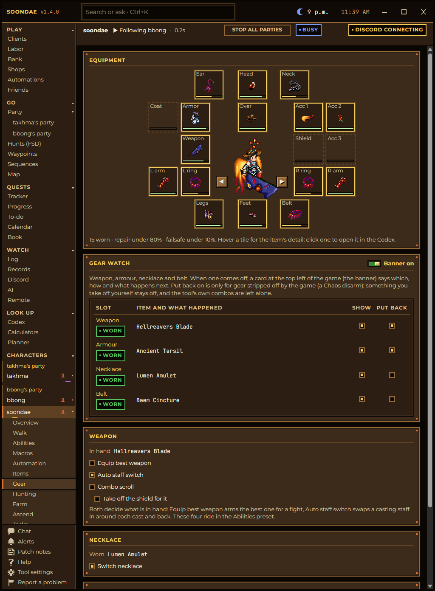

# Game fixes

[Back to the README](../README.md) · Previous: [Getting started](getting-started.md) · Next: [The farm, ascend, regroup loop](hands-off-loop.md)

The Dark Ages client has a few habits every player has learned to work around. Soondae fixes them for every character
it connects, whether or not its bot is playing. There is nothing to switch on.

## Shift, Ctrl and Alt stuck after Alt-Tab

**The game's bug:** the client keeps its own record of which modifier keys are down, built from the key messages it
is sent rather than from the keyboard. Alt-Tab away, and Alt's key-up (often Shift's or Ctrl's too) goes to the other
window, so the game still thinks it is held. Then a, s, d, f, g and h open their Shift panels, the arrows stop walking,
and chat and the password field take no keys, until you press Shift+Ctrl+Alt yourself.

**What Soondae does:** the moment a game window comes back to the front, the tool presses that release for you, as a
real key release would. It only releases the keys you are not actually holding, so an Alt-Tab you are still in the
middle of is left alone.

## A cancelled trade freezes your character

**The game's bug:** cancel a trade at the wrong moment and the character can no longer cast, use skills or walk until a
dialog is closed.

**What Soondae does:** the character keeps casting, using skills and walking after a cancelled trade.

## Spells and skills gone after leaving an NPC

**The game's bug:** walk off an NPC's map with its menu still open, and the character loses its spells and skills
until it relogs. A bot in that state reads "cast on cooldown" while it cannot heal.

**What Soondae does:** the character keeps its spells and skills, and its bot keeps healing.

## Monsters that stay drawn after they died

**The game's bug:** a monster that died can stay on screen, and a caster keeps spending mana on it.

**What Soondae does:** monsters that look dead are not cast at, targeting moves on, and monsters and items gone for three
minutes are forgotten, so a character casting every second at the start of a farm still casts every second ten hours
later.

## Stranded on a tile, or inside a door strip

**The game's bugs:** a few doors put a character on a tile it cannot walk off (one on Mount Giragan), and a character can
land inside the door strip at a map's edge and stand there until wiggled.

**What Soondae does:** a character pinned on a tile for a minute steps off or recalls out by itself, and one that lands in
a door strip walks out of it.

## Dialogs that close the game

**The game's bug:** answering some NPC pages too fast closes the client (the Tagor Inn welcome, the Loures Harbor ferry,
the Medenia caravans, Braz's gem purchases).

**What Soondae does:** those are answered one page at a time with a pause between answers.

## A server reset logs everyone out

**What Soondae does:** every character logs back in, taking turns so their login screens do not type into each other,
and goes back to the hunt and party it was on. A relog that cannot get back in closes its game after three minutes
(Tool settings ▸ Game ▸ Relog) and says so on Discord, so a stuck login screen never holds an account.

## Every window called "Darkages"

**What Soondae does:** each game it launches is named by its character, "Darkages - <name>", in its title bar, the
taskbar and the Windows volume mixer. Turn it off in Tool settings ▸ Game.

## Gear stripped in a fight

**The game:** a Chaos disarm takes off your weapon, and you notice when you stop hitting.

**What Soondae does:** a card at the top left of the game says which piece came off and what happens next, and gear the
game stripped is put back on by itself. Something you take off yourself stays off. Set it per slot on a character's
**Gear ▸ Gear watch** card.

## Spell art from another era

**What Soondae does:** Tool settings ▸ Animations picks Classic, Legend of Darkness 2010 or the latest spell art for
every game the tool launches, approved one animation at a time side by side. The game's own files are never changed:
the tool builds its own copy beside them and points each game it launches at it.

## Hotkeys that work from any window

Ctrl+PgDn plays or pauses every bot, Ctrl+Del turns attacking monsters on or off for everyone, and Ctrl+PgUp turns all
walking on or off for everyone, whichever window has the focus. The whole list is on **Help**.
