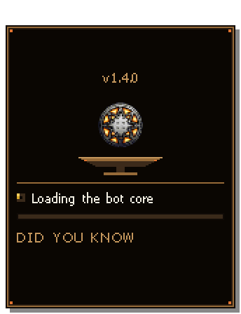

# Getting started

[Back to the README](../README.md) · Next: [Game fixes](game-fixes.md)

## 1. Install

1. Download `Soondae-<version>.zip` from the [latest release](https://github.com/SJhang/Soondae/releases/latest).
2. Clear Windows' download mark before unpacking, or SmartScreen warns on every first start:

   ```powershell
   Unblock-File .\Soondae-*.zip
   ```

3. Unpack it into a folder of its own and start `Soondae.exe`. There is no installer and it needs no admin rights.
   Everything it keeps lives beside the exe: `Settings\` (your characters, parties, hunts, waypoints) and `Logs\`
   (one log per character per day, plus `_app` for the tool itself).

## 2. The first launch



While the tool starts, the launch window shows the Dark Ages icon turning into Soondae's over a brazier fire, the step
it is on in plain words, and a "Did you know" tip. If a step fails (the hotkey hook refused, say), the failure takes the
tip's place and says what went wrong, and the tool starts anyway.

Then the main window opens on **Clients**. On a first run it is empty and points you two ways:

- **Tool settings ▸ Game**: where your `Darkages.exe` is, if the tool did not find it. Use **Grant access** if Windows
  will not let the tool write into the game's folder.
- **Tool settings ▸ Old tool**: bring your old setup over (below).

<br clear="right">

## 3. Connect a character

Soondae runs its own proxy on the game's port, so a game it launches connects through it.

1. On **Clients**, add your characters and their KRU accounts (or import them from the old tool, below). They are kept
   in the tool's own `Settings\` folder on your PC.
2. Press **Launch** on one, or **Launch all**. The tool starts a game per character, logs it in, and the character
   appears on the left rail under **Characters** once it is in game.
3. Click the character on the rail to open its pages. Its **Overview** has Play, Pause and Stop: the bot does nothing
   until you press Play.

Each game window is named after its character, "Darkages - <name>", in its title bar, the taskbar and the Windows volume
mixer, so you can tell them apart (turn it off in Tool settings ▸ Game). Running several games at once is the
**Multiple DA's** switch on Clients.

## 4. Bring your settings from the old tool

If you used the old ProxyBase / ZerioTools tool, nothing has to be set up again.

- Start Soondae **while the old tool is running**, or press **Browse** on **Tool settings ▸ Old tool** and pick the old
  exe. The tool remembers the folder.
- It lists what the old Settings folder holds that Soondae does not yet (accounts, friends, templates, map packs, rules,
  presets and more). Tick what you want and press **Import**.
- Nothing is imported by itself, and the old folder is never written to. Your templates and presets come over unchanged.

## 5. Updates

**Tool settings ▸ Updates** checks this repo when the tool starts and every six hours. The version beside the title
lights up when a new one is out. **Download** fetches it and checks its SHA-256; **Restart and update** swaps the files
once no character is connected and starts the new version. What each version brought is on **Patch notes** at the foot
of the rail.

## Next

- [Game fixes](game-fixes.md): what the tool fixes in the game client, on its own.
- [The farm, ascend, regroup loop](hands-off-loop.md): the tool's headline workflow.
- [Every page](guide.md): the full manual.
