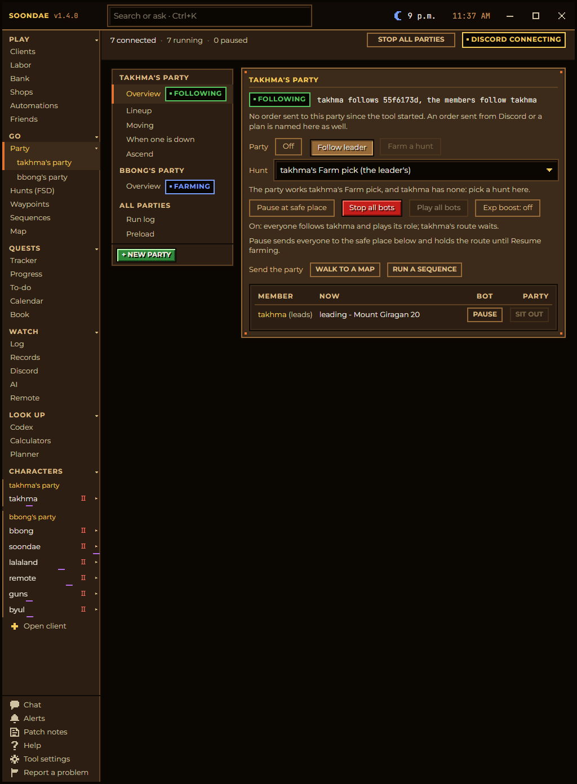
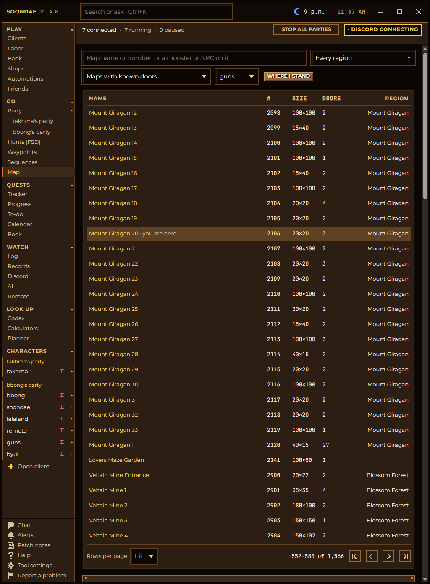
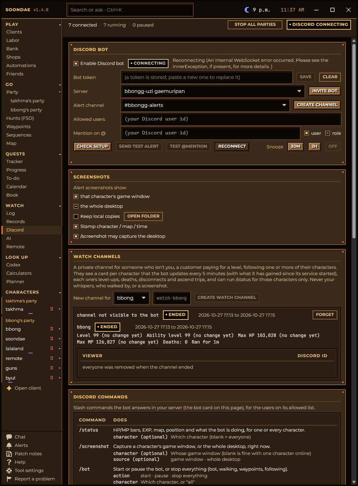
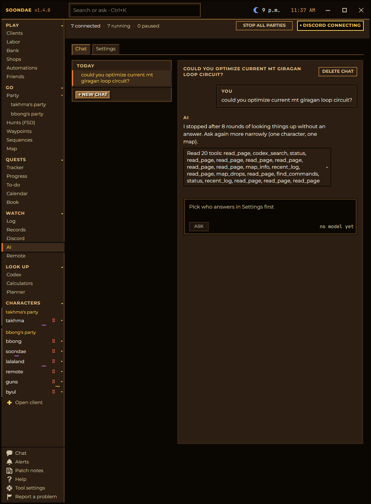
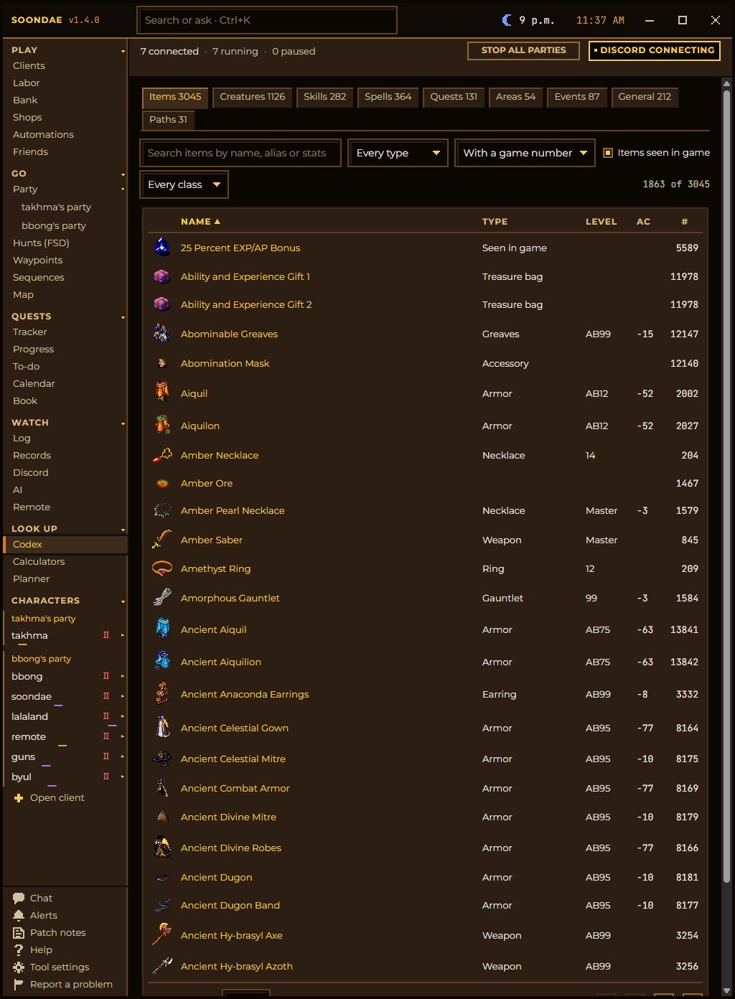
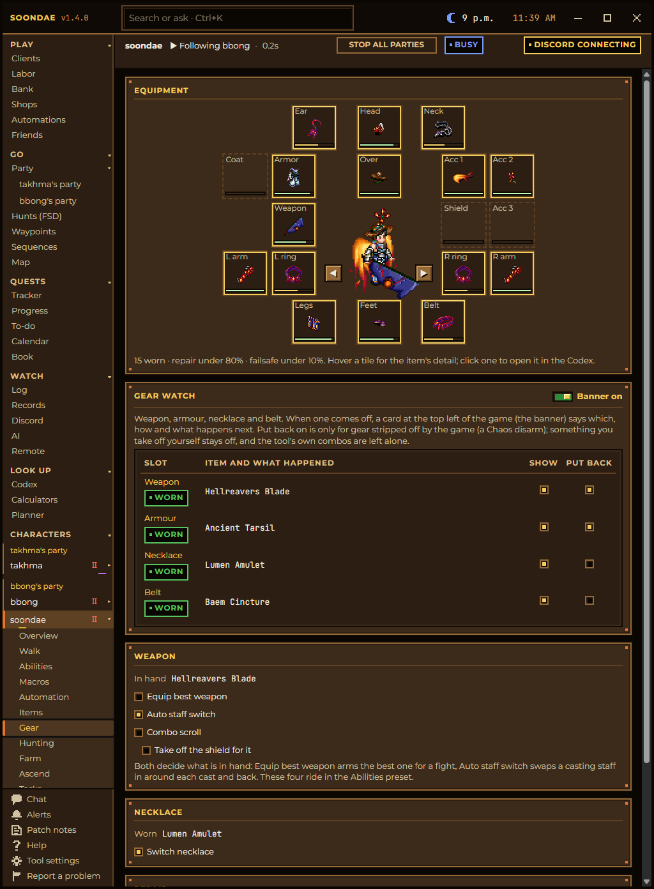

# Every page

[Back to the README](../README.md) · Previous: [How it works](how-it-works.md)

A walk through Soondae in the order of its left rail. The tool's own pages come first, grouped as the rail groups them
(Play, Go, Quests, Watch, Look up, then the rail's foot); each connected character's pages follow. This guide describes
version 1.4.0; what changed since is on **Patch notes**.

**On every page:**

- **The title bar** holds the version (it lights up when an update is out), the search box (**Ctrl+K**: the Codex, every
  page and feature, Help, or a question for the AI), a Temuairan clock with the game's hour beside the real time, and the
  window buttons.
- **The top bar** says how many characters are connected, running and paused, with **Stop all parties** and the Discord
  bot's state.
- **The status strip** under a character's pages says what that character is doing and why, with a danger pill (Calm,
  Busy, Dangerous, Critical) and **Walking now** when a walk is under way.
- **Hover anything** for the detail: every switch, pill and column explains itself in its tooltip.

---

## Play

### Clients

Where every session starts. The launcher lists your characters with their KRU accounts and paid-until dates: **Launch**
one, **Launch all**, or **Relaunch** the last session (who was in game, which parties ran which hunt) in one click.
Star a character to make it a favorite. **Multiple DA's** runs several games at once; the ignore and login-mundane lists
live here too. The Labor column shows when each character's labor is ready again.

### Labor

Every character's labor in one checklist, grouped by KRU account, with **Launch** on each and **Launch next** for the
account, so giving labor across alts is a click each. A rotation logs characters in one after another and hands labor
over between your own characters without whispers; **Close the game too** ends a game once it is out of labor. Gem
orders live here as well: order the gems you want cut and a cutter buys or withdraws the fragments, polishes them
outside the Rucesion Black Market, identifies and banks them.

### Bank

The bank counter: what every character holds in the bank, deposit from the bag and withdraw from the app instead of
typing at the banker, and a send-and-receive loop that passes parcels between your characters.

### Shops

Every player mundane near each of your characters. Open one from the app and buy or sell in a view like the game's
shop; your own shopkeepers are listed at a glance.

### Automations

Plans: steps the tool runs across characters and parties (relaunch, start a hunt, pause at the safe place), written in a
step editor and started by hand or by a trigger.

### Friends

The players your bots treat as safe on screen, with your notes and their Discord id.

---

## Go

### Party

Your parties, one entry each on the rail. A party's **Overview** fits one screen: its state (Off, Following, Farming),
its hunt, where it is heading and the last order it was given, **Pause at safe place**, **Stop all bots**, **Play all
bots**, the **Exp boost** switch, **Walk to a map**, **Run a sequence**, and each member's Pause and Sit out.

The other tabs: **Lineup** (members, leader, each one's role and whether it attacks), **Moving** (Together, follows,
following another party or a player who is not yours), **When one is down** (rescue, relogs, deaths), **Ascend** (who
goes, who waits, the trip's steps), the **Run log** (every floor visited with exp and gold an hour, hunts compared) and
**Preload**. **+ New party** is a wizard.

### Hunts (FSD)

The hunt library and its wizard: maps or circuits, how each map is walked (Loop, Sweep, Guided sweep, Auto), combat per
map and per character with zones, the drop list, loot, trinkets and boosts. Every monster across a hunt's maps is shown
with its sprite, with **Never attack here** per tile. Hunts can be duplicated, exported and imported. The **Worked by**
column names every character on a hunt. See [the loop](hands-off-loop.md) for the whole flow.

### Waypoints

Saved waypoint sets, grouped by place. **Build waypoints** gives any atlas map a starter loop without walking there
first; a set can add another map's after the current one's.

### Sequences

An ordered list of steps for a character or a whole party: walk somewhere, talk to a mundane and pick its answer, equip
or drop an item, wait for a legend mark, run a hunt once round until a kill count is met. **Draft from quest** builds one
from a quest in the book. Every conversation is remembered with the answers that worked. Sequences import and export as
files. The dig bones and the summons come with the tool.

### Map

The world atlas: thousands of maps and doors, opening on where your character stands. Click any map for the shortest
route and **Go to** it, alone or with the party, straight there or farming on the way. Each door shows whether the server
proved it, refused it, contradicted it or never tried it, and who saw it; you can say a door is not a door, or goes
somewhere else, and every character walks by your word until the server proves otherwise. Each map lists its monsters
and NPCs as your characters saw them, and every walk in progress is listed with a Stop.

---

## Quests

Quests has its own heading, like the game's quest log. A quest an NPC hands out is picked up from its page; the tool
never starts walking on its own.

- **Tracker**: the characters with a quest under way, each quest marked ready, counting or next, with kill counts as
  cards (sprite, number, name) and the running sequence's step.
- **Progress**: your characters down the side, the picked quest on the right with its stages, its Codex card and its
  quest line, each quest done, going, open or locked.
- **To-do**: what each character can do next, pinned and dragged into your order; cooldowns and waits show for favorites
  who are logged off.
- **Calendar**: Month, Week and Day views of events, quest cooldowns and waits, for everyone, your favorites, who is on,
  or one character. Discord's `/calendar` sends the same.
- **Book**: each quest's stages, kills, waits and reset, with the NPC's own words on steps confirmed in play. Drafts from
  vorlof's walkthroughs are marked until play confirms them.

---

## Watch

### Log

Every character's log, live. The same lines are kept in `Logs\<character>\<date>.log` beside the tool.

### Records

Deaths with the map and tile, recent tasks, skulls, the ascension log, an inventory rollup across characters, the arena
counter, chest loot, and the **Legend**: every character's legend whole, a Diary of when each mark was got, and a matrix
of characters against the marks you follow.

### Discord

The Discord bot: token, server, alert channel, who may use it, and who gets @mentioned. Alerts can carry a screenshot of
the character's game window or the desktop. **Watch channels** give someone you invite a private channel with a live card
per character (EXP an hour, time to the next level) and `/status` for those characters only. The commands card lists
every slash command with its options: `/status`, `/screenshot`, `/bot`, `/party`, `/hunt`, `/safeplace`, `/halt`,
`/plan`, `/sequence`, `/relaunch`, `/launch`, `/kill`, `/calendar`, `/report` and more.

### AI

Ask about your characters and the game in plain words, on a free local model or your own OpenAI or Anthropic key. It
reads the tool's pages, the Codex, the logs and the quest book, and can run any of the tool's commands once you press
**Run**. Pick who answers on its **Settings** tab first. The same box answers from **Ctrl+K** on any page.

### Remote

A webhook and an MCP endpoint, so other programs (Claude Desktop or Claude Code among them) can read the Codex and run
the tool's commands. Each caller has its own secret and only the kinds of command you allow.

---

## Look up

### Codex

Everything about the game in one book, built from what the game server sent your characters, with vorlof.com filling the
gaps: items, creatures, skills, spells, quests, areas, events, general pages (prefixes and god sets) and paths. Every
column sorts, every name links, items your characters have seen show even before vorlof lists them, and skills and spells
read like the game's book, judged learned, learnable or locked for the picked character. A monster's entry has its
sprite, every map it is on, its drops and an Observed block worked out from your own fights.

### Calculators

vorlof's ascension and Medenian calculators, with each character's base max HP and MP (nothing worn) beside the shown
max.

### Planner

Skill and spell plans per character: what to learn in what order and the materials each step takes, judged against the
character's book, with Copy to and Move to between characters, and the subpath and master checklists.

---

## The rail's foot

- **Chat**: a Messenger-style panel with every character's whispers, and guild, party and world lines in the game's
  colours. It opens only when you toggle it.
- **Alerts**: every alarm in one place (death, disconnect, stuck, GM on screen, watch words, sentry maps), each with a
  Test button, sent as a sound, a toast or to Discord.
- **Patch notes**: a journal of each release, marked new until you open it.
- **Help**: every command, the `/walk` destinations, the Discord commands, the global hotkeys, and **How it works**:
  who wins between the party, the hunt and your own settings, with examples.
- **Tool settings**: the game path and window names, auto-relog, the overlays drawn over the game, chant timing (with
  Fast 0-line attacks and Find the floor), animations, Old tool import and Updates.
- **Support**: the heart icon; the ways to chip in for the servers, GitHub Sponsors among them, each with a QR code.
- **Report a problem**: zips every log since your last report, with an optional note, and sends it to the tool's owner.
  Discord's `/report` does the same.

---

## A character's pages

Click a connected character on the rail and its pages unfold under it.

- **Overview**: Play, Pause and Stop, its meters, hunt, party and combo, who moves it and why, and the character drawn in
  the gear it wears now (the arrows turn it around).
- **Walk**: Destination (any place, saved spot, quest NPC or map, alone or with the party), Waypoints with the floor
  drawn on a canvas (click to place a waypoint, block or door, or type its X and Y), Sequences, Follow any player, Clear
  the map, and the Progress watch.
- **Abilities**: skills and spells on self, players and monsters, read from the character's own book; presets for each;
  Monsters (main target, fight only when mobbed, chase, luring, never attack); Never use here per map; dion keep-up.
- **Macros**: the spell and skill grind lists, optionally on only inside a Training Dojo room.
- **Automation**: rules, combos with their hotkeys, stances that retune your rules at each danger level, trinkets and
  consumables, and the Event Workbench.
- **Items**: the bag as the game lays it out, loot and drop lists, deposit and withdraw, Auto-Deposit, Identify Items and
  spawn rewards.
- **Gear**: the paperdoll with durability under each slot, the Gear watch (put back what the game strips), best weapon,
  staff switch, combo scroll, necklace switch and repair.

  

- **Hunting**: dion keep-up, self cures, heal requests, and the Run journal that records casts and damage for the
  Codex's Observed numbers.
- **Farm**: AutoFarm, the durability failsafe, hunt rotation, and Deaths: what happens when this character dies.
- **Ascend**: Ascend at, what the box buys, Instant Ascend, the trip's steps, base max HP and MP.
- **Tasks**: labor, improve profession, prayer, buy gems, and a Rescue station.
- **Mundane**: run your character as a shop: its switches and identity, its dialog menu and vendor rules, several
  customers served at once from a queue.
- **Settings**: the misc switches, realistic delays, speech and the template manager. Your old tool's templates import
  unchanged.

---

## Hotkeys

These work from any window, the game's included:

| Keys | Does |
|---|---|
| Ctrl+PgDn | Play or pause every bot |
| Ctrl+Del | Attack monsters on or off for everyone |
| Ctrl+PgUp | All walking on or off for everyone |

The rest, and every in-game command, are on **Help**.
