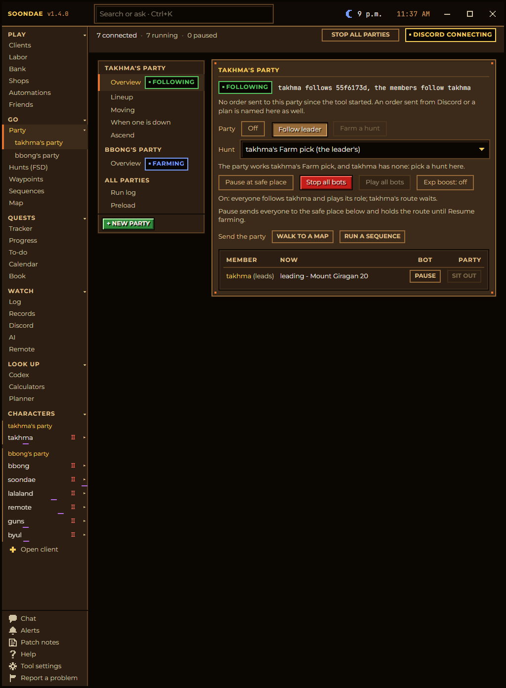

# The farm, ascend, regroup loop

[Back to the README](../README.md) · Previous: [Game fixes](game-fixes.md) · Next: [How it works](how-it-works.md)

The loop Soondae is built around: a party farms its hunt, a character whose experience box is full leaves to ascend,
the party waits or keeps farming, everyone regroups and farms on. Set it up once and it runs through the night, until
you stop it.

## 1. A hunt: where to farm

**Go ▸ Hunts (FSD)** is your hunt library. **New hunt** opens a wizard:

1. **Maps.** Pick the floors, or write a circuit as the floors are named (`33<>40` walks Muisir Path 33 to 40 back and
   forth). Each leg is routed over the map atlas. You can also start one from the **Map** page: shift-click a range
   of an area's maps.
2. **How each map is walked.** Loop (by waypoints), Sweep (see the whole floor), Guided sweep, or Auto. The style says
   what it does right under it. Sweeping needs no waypoints at all.
3. **Combat.** One grid sets the skill and spell presets for everyone on a map and for each character, a click per pick.
   A floor can have zones (a prepare-here zone before a boss) with their own loadout.
4. **Review**, then save. The hunt also carries its drop list (Drop it / Keep it per item, with vorlof's drop rates and
   what your characters saw), its loot list, trinkets and boosts.

## 2. A party: who farms

**Go ▸ Party ▸ + New party** walks you through it: the members (up to 13, like the game's group window), the leader,
and each member's role (who attacks, who supports, who is a Leech that only gains). Pick the party's hunt. A party
owns its hunt: every member drops, boosts, parks at the safe place and ascends by the party's hunt.

Set the party to **Farm a hunt**. The leader walks the hunt; the others follow, fight and heal by their roles.
**Together** keeps the party in one chunk: the leader waits for a member that falls behind.

## 3. Ascend: when the box is full

On a character's **Ascend** page, **Ascend at** sets how full the experience box gets before it goes (3b, say), and
what the box buys: HP or MP, at the god or by an EXP gem, with **Instant Ascend** sending the purchases in one burst.

When the box fills, the party follows its rules (**Party ▸ the rules**):

- **Everyone goes at once**, or only the full ones, while **the rest wait at the safe place** or keep farming.
- **Ascend at the end of a lap**: a full character waits until the party is back at the safe place, so nobody is sent off
  from deep in a loop. A Leech can be set to leave at once and rejoin where the party is.
- The trip itself is a chain of steps you can switch on and off: park, recall (dachaidh first, then a town song, a walk
  only as the last resort), the Mileth altar or the EXP gem, buy, and back. It takes off armour and belt before dying at
  the altar and wears them again after, and can Repair all in Mileth on the way.
- A banner on every member's game window and every page shows who is ascending and who waits.

## 4. Regroup and farm on

The ascender walks back to the party, the party gathers, and the hunt walks on to its floor. Things that used to break
the night are handled on the way:

- **A death.** The character gets out of the afterlife by itself and runs back to its hunt or party; Records keeps where
  it fell. A skulled member is revived by the nearest of your characters carrying a Komadium.
- **A disconnect.** A member whose game closed gets a fresh game with its saved settings, and the party waits where it
  dropped (5 minutes by default), then farms on. After a server reset everyone logs back in and the session picks up.
- **A stuck walk.** The Progress watch notices a walk that stops getting closer, steps your own characters out of the
  way, and says why. A door that never warps is written off and the walk takes another way.

## 5. Watch it and stop it

- **Pause at safe place** sends the party to its safe place and holds it; **Resume farming** walks it back.
- **Stop all parties** (top bar) halts every party and ascend trip on every character. **Ctrl+PgDn** plays or pauses every
  bot from any window.
- **Discord**: `/status` for each character's bars and what it is doing, `/party pause`, `/screenshot`, and alerts when
  a character dies, disconnects or gets stuck. A **watch channel** lets someone you invite follow your characters' pace.
- **Party ▸ Run log** keeps every floor a hunt visited, with exp a minute and why it ended, so you can compare hunts.
