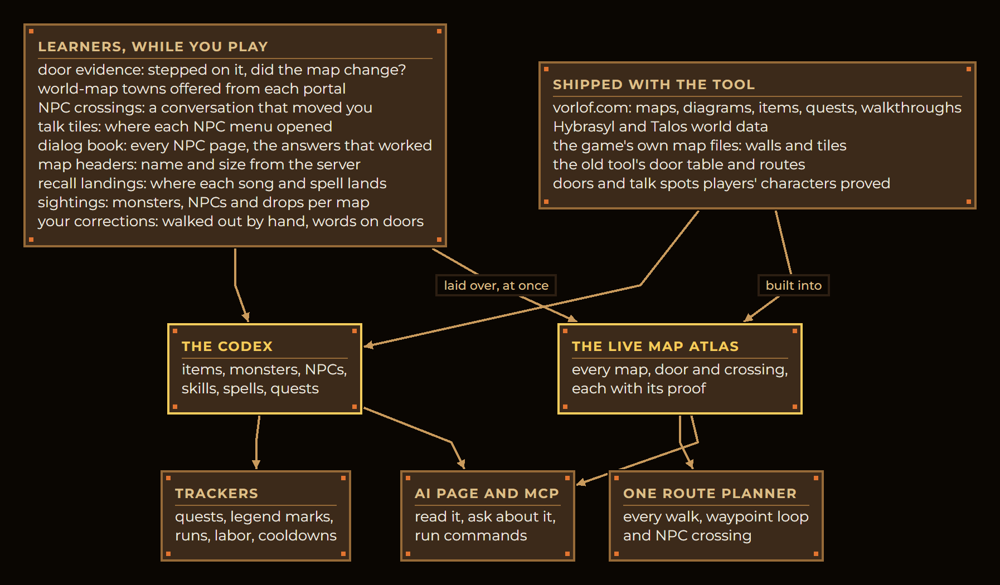
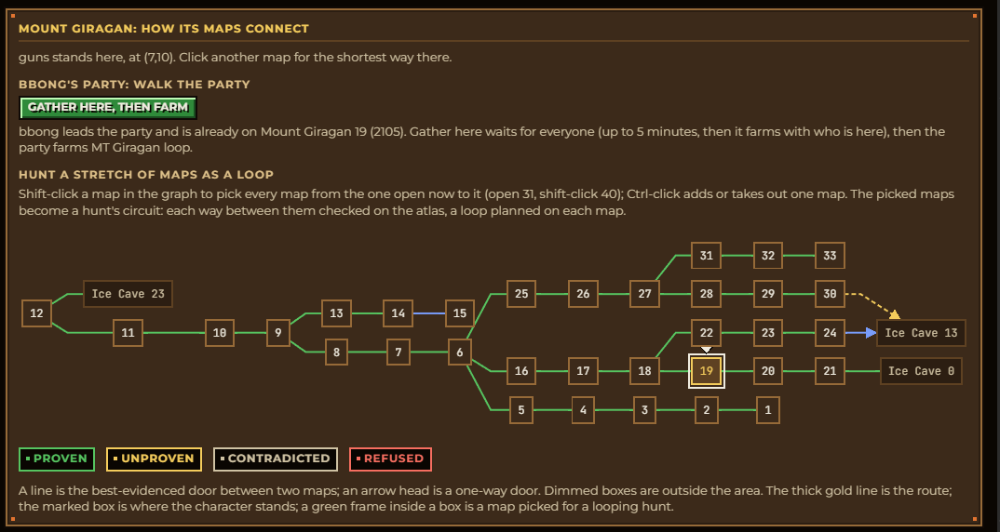
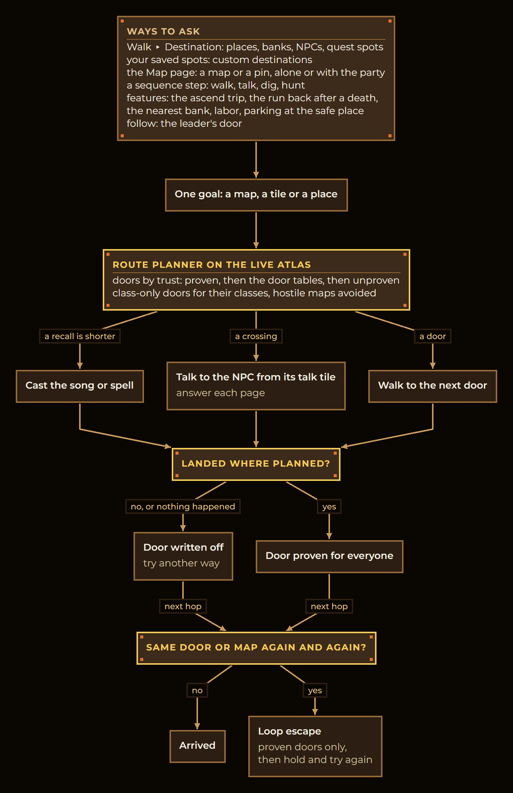
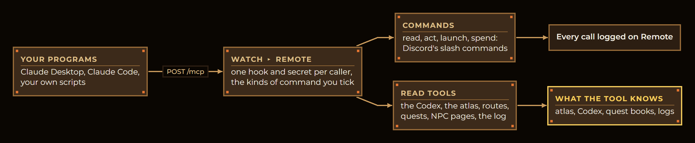

# How it works

[Back to the README](../README.md) · Previous: [The farm, ascend, regroup loop](hands-off-loop.md) · Next: [Every page](guide.md)

What Soondae knows about the world, how it learns more while you play, and how every walk, waypoint and NPC
conversation uses it. One rule runs through all of it: **the game server is the source of truth.** What the server did
when your characters stepped on a tile beats any drawing, wiki or old table, and vorlof.com only fills in what the server
never sends (stats, drop rates, walkthroughs).

## The picture

## The map atlas

The atlas is every map in the game, every door between them, and every crossing made by talking (a caravan, a ferry, a
say-spot). It ships built from vorlof's map lists and drawn diagrams, the Hybrasyl and Talos world data, the game
client's own map files and the old tool's door table. Every door carries a verdict: proven, refused, contradicted or
unproven.

Then it keeps growing on your PC. The **live atlas** is the shipped one with everything your characters proved laid over
it, rebuilt the moment a new proof comes in, so a door the leader just walked through routes its followers on the next
tick. Each release folds what players' characters proved back into the shipped atlas.

You can see all of it on **Go ▸ Map**: each door's verdict and who saw it, and your own word on a door ("not a door",
"goes somewhere else", "broken") which every character follows until the server proves otherwise.

Each map's card shows its doors with what proves each, and the monsters the server showed your characters there; see
[the Map page](guide.md#map).

## The learners

Each learner watches what the server does and writes it down, shared by every character in the tool.

| Learner | What it watches | What it changes |
|---|---|---|
| **Door evidence** | A step onto a door tile: did the map change within a moment? | A yes proves the door for everyone at once; two characters' noes retire it |
| **World-map towns** | The towns the world map offers from each portal | Towns not offered there are never pressed from that spot |
| **NPC crossings** | A conversation followed by a map change | The crossing joins the atlas with its NPC, tile, option and pages, and the door it stood in for leaves the planner |
| **Talk tiles** | The tile each NPC's menu opened from | Walks to that NPC stop on a tile it answers from (up to 7 tiles away) |
| **Dialog book** | Every page an NPC showed, word for word, and which answers worked | Sequences answer a page they have no answer for with the one that worked before; the AI can read them |
| **Map headers** | Each map's name and size from the server | A map the atlas never knew is drawn and routed at once |
| **Recall landings** | Where each town song and recall spell put a character | Walk or recall is weighed on real landings |
| **Sightings** | Monsters, NPCs and drops seen on each map | Map lists, the Codex, hunts' drop lists, Never attack here |
| **Your corrections** | A stuck walk you walked out by hand; your words on doors | The way you took is used next time; a broken door is never walked |

Things that only look like doors are told apart: a recall, a death, a citizens' gate putting you outside, the game
moving a whole group (Muisir training) and a caravan ride all move a character without a door, and none of them is
learned as one.

## The trackers

Trackers keep score of each character, in game or not:

- **Quests**: a quest an NPC hands out is picked up from its page; its stage comes from the NPC's pages and the
  character's legend marks; kill counts follow the quest's own rule (the party's kills, kills that gave experience, or
  last hits only). They feed the in-game tracker card and **Quests ▸ Tracker, Progress, To-do, Calendar**.
- **Legend**: every mark, kept whole, with when each was got (**Records ▸ Legend**).
- **Runs**: each floor a hunt visited, exp and gold an hour, deaths with their tile, ascends (**Party ▸ Run log**,
  **Records**).
- **The run journal**: what each character cast and the damage that followed, worked into each monster's HP and how each
  ability scales (the Codex's Observed numbers).
- **Labor and cooldowns**: when each character's labor and each quest is ready again (**Labor**, **Quests ▸ Calendar**).

## From "go there" to a step

Every way of asking a character to go somewhere becomes the same goal, and **one planner** plans them all, so the Map
page, the Walk tab, a sequence and the ascend trip never disagree about the way.

**Waypoints** are the other half: inside one map. A hunt floor's waypoint set is the loop a character walks while it
farms; a map with no set can be swept instead (walk to the parts of the floor not seen yet) or given a starter loop built
from the atlas, kept clear of doors. Waypoints never decide how to get between maps; the planner does.

**NPC interactions** use the same pieces: a walk to an NPC ends on one of its talk tiles; a crossing is a conversation the
planner can route through; a sequence's talk step answers each page from the dialog book; and the server is never sent a
page it has not shown, unless that sequence is known to be safe to send in one go.

## What MCP offers

Soondae is also an [MCP](https://modelcontextprotocol.io) server, so a program you trust (Claude Desktop, Claude Code, your
own script) can read the game data and drive the tool. Turn it on at **Watch ▸ Remote**: each caller gets its own secret,
and you tick which kinds of command it may use.

**Read tools** (for a caller allowed to read):

| Tool | Answers |
|---|---|
| `codex_search` | The Codex by words: items, skills, spells, quests, areas, guides, paths, prefixes, monsters, NPCs |
| `codex_entry` | One Codex entry in full, each fact with the page it came from |
| `codex_items` | Items by who can use them: class, level range, slot |
| `map_drops` | What drops on a map or from a monster: your characters' pickups first, then vorlof's rates |
| `item_sources` | Where an item comes from: the monsters that drop it, best rate first, and your characters' pickups |
| `map_info` | A map from the atlas: name, size, region, danger, its doors and what proves each |
| `route` | The way from one map to another, as the walker plans it |
| `quest_tracker` | A character's quests under way, as its in-game tracker shows them |
| `quest_todo` | A character's to-do list, in your order |
| `quest_status` | One quest judged for a character: doable, locked and what is missing, or done |
| `quest_steps` | A quest's walkthrough as steps: talk to whom and where, kill how many of what |
| `npc_dialog` | Every page an NPC showed your characters, word for word |
| `recent_log` | A character's log for today: what the bot decided and why |

**Commands** are the same ones Discord's slash commands run (`status`, `screenshot`, `bot`, `party`, `hunt`, `safeplace`,
`halt`, `plan`, `sequence`, `relaunch`, `launch`, `kill` and the rest), each in one of four kinds you allow per caller:

| Kind | Means |
|---|---|
| **Read** | Looks and answers; changes nothing |
| **Act** | Changes what the tool or a character is doing: start, stop, edit, walk, say |
| **Launch** | Starts game clients and logs characters in |
| **Spend** | Spends what can't be got back: experience on an ascend, gold on a repair, items dropped |

The **AI** page uses the same tools from inside the tool, so it can say why a character stopped or plan a quest, and runs
a command only after you press **Run**.
